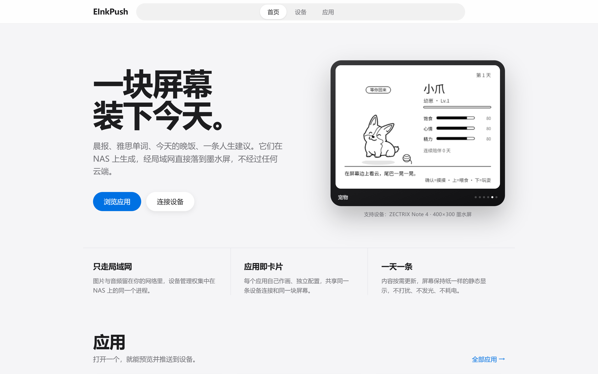

# EinkPush

ZECTRIX Note 4 墨水屏 **LAN v1 推送协议的 Node.js 客户端**，以及可直接跑在 NAS 上的 Web 推送服务 + 六个墨水屏应用（今天、背单词、今天吃什么、人生指南、宠物、掷杯筊）。
本项目使用AI协助完成。

<p align="center">
  
</p>

协议实现对齐 [Rust SDK](https://github.com/itopinion/zectrix-local-push-sdk)（`itopinion/zectrix-local-push-sdk`），并用与 Rust 单元测试同源的 golden 向量验证（`npm test` 含模拟设备的集成测试、异常路径测试、Web 接口测试与各应用的端到端测试）。

**设备地址不用写死在启动命令里**：服务可以直接启动，然后在页面上填写 IP 并保存，配置落盘到 `data/config.json`，重启后继续生效。

## 功能

- **协议层**（`src/packet.js`）：16 字节包头编解码、16 种消息类型、结果码/结束原因映射、INFO/STATUS/PALETTE/IMAGE_STATUS 解析
- **连接管理**（`src/client.js`）：直连 IPv4 **或主机名**、INFO → CONNECT → PALETTE 握手、5s PING 保活 / 15s 超时终态、同序号有限重传（1500ms 起步退避至 4s、总期限 15s）、**`close()` 主动发 CLOSE 释放管理权**、**`close()` 后可再次 `open()`**
- **设备地址配置**（`src/settings.js`）：页面填写 / 环境变量 / 启动参数三种来源，页面保存的值优先并持久化；改地址会先给旧设备发 CLOSE 再切到新地址
- **访问认证**（`src/auth.js`）：全站登录页（只输密码），登录后发签名 Cookie 维持会话；API 额外支持 `?token=<密码哈希>`。密码哈希保存在 `data/config.json`，初始密码 `helloworld`，可在「设备」页修改
- **图像管线**（`src/image.js`）：PNG → sRGB→线性亮度 → Lanczos3 等比缩放 → 设备色板量化 + 按位深选择的抖色（仅 MONO 用 Floyd–Steinberg，GRAY4/GRAY16 纯量化）→ MSB-first 位打包（1/2/4bpp）→ zlib(level 6)
- **图片推送**：IMAGE_BEGIN/DATA 分片（1024 字节/块）→ IMAGE_STATUS 64 位接收位图补传 → RESULT/STATE 确认显示完成；刷新阶段不再重发数据块，多图任务排队串行上传
- **音频**（`src/audio.js`）：PCM16 16kHz → Opus 60ms 帧（WASM 编码器）；设备录音上行重组（乱序、丢帧补偿、末帧裁剪）
- **语音服务**（`src/speech.js`）：全局 TTS/ASR 能力，配置落盘 `data/speech.json`；TTS 内置 Edge 在线朗读（中英文 50+ 音色、免密钥），ASR 走 OpenAI 兼容的 `POST {baseUrl}/audio/transcriptions`，应用通过 `ctx.speech` 复用
- **录音可靠性**：3s 无进展 / 125s 超长 / 连接中断都会强制收尾并释放设备；结束原因、丢帧数随事件上报；WAV 自动落盘并按数量淘汰旧文件
- **Web 服务**（`src/server.js`）：REST + SSE + 管理页面，所有错误（含超大请求体、非法图片、未知接口）统一返回 JSON
- **应用层**（`apps/`）：每个应用自带数据、渲染与页面，服务层只提供协议/连接/事件。当前内置 **今天**（天气、空气质量、月历、历史上的今天、五行穿搭）、**背单词**（词库、拼写/翻卡、SM-2 复习）、**今天吃什么**（确认键随机换菜）、**人生指南**（767 条循证建议，确认键翻下一条）、**宠物**（云端成长，可叠加到其他应用图片）与 **掷杯筊**（确认键掷杯占卜）；设备停在远程模式界面时，上/下键循环切换应用。接口挂在 `/apps/<id>/`，详见 [`apps/README.md`](./apps/README.md)
- **渲染公共层**（`apps/shared/canvas.js`）：400×300 画布 → 3 倍超采样 → 平滑降采样保留灰阶抗锯齿 → USM 锐化（默认 0.7，笔画更干脆，`sharpen: false` 可关、`sharpenAmount` 可调）→ 跨平台中文字体解析（`ZX_FONT` → `data/fonts` → 系统字体）

## 快速开始

```bash
npm install

# 运行测试（含与 Rust SDK 对齐的 golden 向量 + 模拟设备集成/异常路径/Web 接口/应用端到端测试）
npm test

# 启动服务（不需要设备地址也能启动）
node src/index.js --web 8080
```

打开 `http://<NAS-IP>:8080/`，会跳到登录页，输入初始密码 `helloworld` 即可进入。登录后在「设备」页填设备IP地址（`192.168.1.x`，设备IP地址在设备的设置页右上角，端口留空即用默认 32342），点 **保存并连接** 即可。之后推图/播放都不用再碰启动参数。

密码在「设备」页的「访问密码」卡片修改；改完当前浏览器自动保持登录，其他浏览器需用新密码重新登录。

### API 鉴权

页面通过登录后的会话 Cookie 保持登录；API 还可以把**密码哈希**作为参数直接调用。哈希在「设备」页的「访问密码」卡片里展示，等同密码，请勿外传。

```bash
# token 即当前密码的 SHA-256 哈希
curl 'http://nas:8080/api/status?token=<token>'
```

**开放到公网时请务必放在 HTTPS 反向代理之后**，否则登录密码与 URL 里的 token 都会明文传输。未登录访问页面会 302 到 `/login`，会话有效期 30 天，改密后其他浏览器上的会话立即失效。

忘记密码时，删除 `data/config.json` 里的 `passwordHash` 字段并重启，即恢复初始密码 `helloworld`。

也可以把地址作为启动初值（页面保存过的值优先于它）：

```bash
node src/index.js --device 192.168.1.x --web 8080
DEVICE_IP=192.168.1.x WEB_PORT=8080 node src/index.js
```

把推送与播放：

```bash
# 推送 PNG（mono/gray4/gray16）；token 为当前密码哈希
curl -X POST --data-binary @card.png 'http://nas:8080/api/show?format=gray16&token=<token>'

# 播放 PCM16 LE 16kHz 单声道（?volume=0..100）
curl -X POST --data-binary @clip.pcm 'http://nas:8080/api/play?volume=70&token=<token>'

# 中止当前播放/录音、状态、事件流、历史
curl -X POST 'http://nas:8080/api/stop?token=<token>'
curl 'http://nas:8080/api/status?token=<token>'
curl -N 'http://nas:8080/api/events?token=<token>'   # SSE：按键、录音、断开
curl 'http://nas:8080/api/history?token=<token>'
```

管理页面：`http://nas:8080/`（设备地址配置、设备状态、推送、停止、实时事件日志）。
应用入口：`http://nas:8080/apps`（今天 / 背单词 / 今天吃什么 / 人生指南 / 宠物 / 掷杯筊，各自带配置与预览页）。

数据目录（都在 `./data/` 下，换个位置只改对应环境变量）：

```
data/
  config.json                 页面保存的设备地址、字体与访问密码哈希
  speech.json                 全局语音服务配置（TTS 音色、ASR 供应商）
  recordings/                 设备上行录音 WAV
  fonts/                      放 .ttf 可覆盖系统字体（可选）
  today/config.json           今天应用的配置
  vocabulary/config.json      背单词配置
  vocabulary/library.json     词库（首次启动用内置雅思 6000 词初始化）
  vocabulary/progress.json    复习进度（按单词哈希记录）
  pet/state.json              宠物成长状态
```

## API

所有接口（包括 `/apps/<id>/api/*`）都需要鉴权：页面登录后自动带会话 Cookie，API 可用 `?token=<密码哈希>`；下表省略了 token 参数。`GET /login` 与 `POST /api/login` 除外。

| 方法与路径 | 说明 |
| --- | --- |
| `POST /api/login` | 请求体 `{"password":"密码"}`；校验通过后设置 `inkpush_session` 会话 Cookie（HttpOnly、SameSite=Lax，30 天） |
| `GET /api/config` | 当前生效的设备地址、来源（`file`/`startup`/`none`）、默认端口、配置文件路径、`authToken` |
| `POST /api/config` | 请求体 `{"device":"192.168.1.x:32342"}`；校验通过即保存到 `data/config.json` 并切换目标设备 |
| `POST /api/password` | 请求体 `{"password":"新密码"}`（6～128 位）；需登录会话，更新密码与 API 令牌并落盘，返回新 `token` |
| `POST /api/connect` | 强制重连当前地址并返回设备摘要（页面「保存并连接」用它验证配置是否真的通） |
| `GET /api/status` | 连接状态 + 电量/充电/RSSI |
| `POST /api/show?format=mono\|gray4\|gray16` | 请求体为 PNG 二进制；不传 format 时按设备能力推最高画质（16 灰阶设备即 GRAY16），传了则夹取到设备能力以内；成功 = 设备确认物理显示完成 |
| `POST /api/play?volume=65` | 请求体为 PCM16 LE 16kHz 单声道；返回 `end: Completed\|Interrupted\|Limit\|Stopped` |
| `POST /api/stop` | 中止当前播放或录音，返回被停止的流号（无目标时为 `null`） |
| `GET /api/events` | SSE 事件流（connected / key / recordingStarted / recording / disconnected / deviceChanged），15s 心跳 |
| `GET /api/recordings/<id>.wav` | 下载设备上行录音（16kHz 单声道 WAV） |
| `GET /api/history` | 最近 100 条事件与 50 条推送/播放历史 |
| `GET /api/speech` | 全局语音配置（TTS 音色、ASR 供应商）与可用音色列表 |
| `PUT /api/speech` | 校验并保存语音配置到 `data/speech.json`，所有应用立即生效 |
| `POST /api/speech/test` | 请求体 `{"text":"apple"}`，只合成不推设备，用来确认 Edge TTS 可达 |
| `POST /api/close` | 主动断开（发送 CLOSE），释放设备管理权 |
| `GET /apps` | 应用总览页 |
| `GET /api/apps` | 应用列表（含各应用的 `status()` 快照与入口地址） |
| `/apps/<id>/*` | 各应用自己的页面与接口（见下节） |

状态码约定：参数/格式错误 400、设备忙碌或正在录音/尚未配置地址 409、设备处理失败 502、连接断开 503、结果未知 504、请求体超限 413、未知接口 404。所有错误响应都是 `{"ok":false,"error":"..."}`。

## 应用

应用放在 `apps/`，与服务共用同一个进程与端口，但**业务逻辑全在应用自己手里**：服务层只给协议、连接、录音落盘、事件与页面托管。
开发约定（ctx、事件形状、错误映射、串行化要求）见 [`apps/README.md`](./apps/README.md)。

**上/下键切换应用**：设备停在远程模式界面时，短按上键或下键会按注册表顺序（今天 → 背单词 → 今天吃什么 → 人生指南 → 宠物 → 掷杯筊）循环切换，并推送该应用当前的一屏卡片。背单词作答期间不会被切换抢走：上键听当前词发音，下键记「忘了」或跳过。

### 今天 `/apps/today/`

参考实现：[happynailinzz/zectrix-morning-brief](https://github.com/happynailinzz/zectrix-morning-brief/blob/3b3ddab6fa48eed580dc99b196b826329475ca50/scripts/morning_brief.py) 的 `morning_brief.py`。

天气 / 空气质量 / 月历（含节气标记）/ 历史上的今天 / 五行穿搭，画成 400×300 灰阶图推设备。

| 接口 | 说明 |
| --- | --- |
| `GET /api/config` / `PUT /api/config` | 地点（名称 + 经纬度 + 时区）、cron、是否启用、格式、是否推「明日」、和风天气 Key / API Host |
| `GET /api/geocode?name=城市` | 城市名查经纬度/时区（填了和风 Key 走和风 GeoAPI，否则用 Open-Meteo 地理编码） |
| `GET /api/preview.png?date=YYYY-MM-DD` | 浏览器预览（不推设备），同时是缓存入口 |
| `POST /api/push` | 手动推送一张（body 可带 `date` / `tomorrow`） |
| `GET /api/failure.png` | 最近一次失败的占位图：推失败时设备上也能看到原因 |

数据源全部可降级（某个源挂了就用占位内容继续出图）。**日柱、节气与月历网格是本地算的**（儒略日推干支 + 太阳视黄经解节气 + 日期网格），不依赖抓网页；时间以地点时区为准。「历史上的今天」取自百度百科按日静态 JSON，支持任意月日，取不到时卡片显示占位文案。

**天气源**：默认用免费的 Open-Meteo，无需 Key；在页面配置里填入和风天气 Key 后改走和风 `/v7/weather/3d` + `now` + `24h`。和风控制台给的 API Host 若不是 `devapi.qweather.com`（例如私有域名），在页面的「和风 API Host」里填写，留空则用默认值。全部配置都在 `/apps/today/` 页面上完成，不依赖环境变量。

**改城市会自动换坐标**：保存时若只改了地点名称、经纬度仍是旧值，服务端会按新城市名解析经纬度/时区并回填；手动改了经纬度则以手填值为准。解析不到会返回 422 提示手动填写，避免出现「名字是北京、坐标还停在杭州」。

首次启动（没有 `data/today/config.json`，或配置里的地点仍是内置默认值）时，会按服务所在网络的公网出口**自动定位一次**（浏览器只能给出内网地址，没有参考价值），定位结果写入配置供后续复用；定位失败才退回默认地点。

### 背单词 `/apps/vocabulary/`

参考实现：[itopinion/zectrix-vocabulary](https://github.com/itopinion/zectrix-vocabulary)。

内置词书是 **雅思 6000 词**：30 个 List × 200 词，每词带音标与中文释义，按当代语料库词频从高到低排（先学高频词）。数据来自 [ECDICT](https://github.com/skywind3000/ECDICT) 的 `ielts` 标签词条，再用 [qwerty-learner](https://github.com/Kaiyiwing/qwerty-learner) 的雅思核心词表补齐，由 `scripts/build-ielts-wordbook.mjs` 筛选生成；产物 `apps/vocabulary/data/ielts-6000.json`（340 KB）随仓库提交，运行时不需要联网。

```bash
# 只在需要更新词书时跑一次（产物已提交，日常运行不依赖网络）
node scripts/fetch-ecdict.mjs      # 分块下载 ~65 MB 的 ecdict.csv 到 .cache/，逐块校验后可断点续传
npm run build:wordbook            # 默认 6000 词、每 200 词一个 List
node scripts/build-ielts-wordbook.mjs --limit 3000 --size 100
```

生成规则：`tag` 含 `ielts` → 去掉专有名词/词组/缩写/无词频无标注的生僻词，以及释义写成原形屈折形式的词条（`walls: wall 的复数`）→ 按词频排序；雅思标注词只有 5 千出头，不足 6000 时用 `tag=toefl` 的共考词按词频补足 → 释义压成一行、最多三个义项、按屏幕宽度截断（先剥掉括号里的修饰语，避免把核心义切掉）→ 音标统一成 IPA：西里尔 `ә`/`є`、编码损坏的 `^`/`3`/`\\` 都映射回 `ə`/`e`/`g`/`ɜ`，多套读音只留第一套（`/ˈkɔndʌkt, -dəkt/` → `/ˈkɔndʌkt/`）。

> 词书改版后，若 `data/vocabulary/library.json` 已经存在（你加过自己的教材或词），老词书不会自动替换——删掉它就会用新的内置词书重建（`progress.json` 里的复习进度按单词存，不受影响）。

下载这一步值得单独说明：GitHub 及其镜像的 Range 请求经常半途断流，`curl -L` 会把半截内容写进文件而不报错，拼出来的 CSV 里混着压缩二进制，「解析出 17 万行」（实际 74.5 万）就再也凑不满 6000 词。`scripts/fetch-ecdict.mjs` 按 2 MB 分块、逐块校验长度/控制字节/UTF-8，失败换镜像重试。

词库结构是 教材 → 单元 → 单词，可以自建教材/单元、批量导入自己的词表；练习有拼写/翻卡两种，复习用 SM-2，交互直接走设备的按键与录音上行。

| 接口 | 说明 |
| --- | --- |
| `GET /api/config` / `PUT /api/config` | 范围、每轮词数、模式（auto/flashcard/spelling）、排序、音量 |
| `GET /api/library` | 教材/单元/词量 + 总数、到期数、已学数 |
| `GET/POST/DELETE /api/library/words` | 单词增删查（按内容哈希做 id，改单元名不影响复习进度） |
| `POST /api/library/import` | 批量导入：每行 `单词<TAB>释义[<TAB>音标]`，逗号/多空格也认，`#` 为注释 |
| `POST /api/session` | 开始新一轮（默认到期的先来，不足补新词） |
| `POST /api/session/answer` / `next` / `stop` | 翻答案、记成绩并前进、结束并返回汇总 |
| `GET /api/session` | 当前会话快照（阶段、当前词、计数、提示、下次复习） |
| `GET /api/preview.png` | 当前一屏的预览 |

设备端交互：**确认**=翻答案 / 记「记得」，**下滑**=忘了（答案页）/ 跳过（其他阶段），**上键**=听当前词发音（开始一轮时已自动预生成整组 TTS 缓存），**长按语音键**=报字母（拼写模式）。

语音：**TTS 与 ASR 是服务层的全局语音服务**（`src/speech.js`，配置在首页「语音服务」，落盘 `data/speech.json`），背单词只负责调用。TTS 内置 Edge 在线朗读，中英文 50+ 音色可选（默认 `en-US-AriaNeural`），不需要密钥，也不占 NAS 算力。**ASR 是可选供应商配置**：填 baseUrl、模型和密钥（OpenAI 兼容的 `POST {baseUrl}/audio/transcriptions`），配了才启用拼写判分，否则自动降级为翻卡模式（功能闭环不依赖 ASR）。首页的「试听」可以直接确认服务器能否访问 Edge TTS。

### 人生指南 `/apps/life-guide/`

把开源项目 [HowToLiveBetter](https://github.com/eternity4719/HowToLiveBetter)（《高性价比人生指南》）的 **767 条循证建议 / 34 个章节**做成每日卡片：一条一屏，标题给结论，正文是原文的「说人话」，底部标出钱 / 时间 / 毅力 / 收益与证据等级（A/B/C）。

| 接口 | 说明 |
| --- | --- |
| `GET /api/state` | 当前条目、位置、筛选条件、章节与证据等级列表 |
| `POST /api/next` | 翻下一条（`shuffle:true` 为随机），默认推送设备；`push:false` 只更新网页 |
| `POST /api/filter` | 按章节 `chapter` / 证据等级 `evidence` 筛选，`all` 表示不过滤 |
| `POST /api/push` | 只推当前这张 |
| `POST /api/arm` | 网页接管 / 交还设备确认键（租约 2 分钟，关页面自动失效） |
| `GET /api/preview.png` | 当前卡片预览 |

设备端交互：**确认**=翻下一条。网页打开时按确认键或空格同样翻页，并可在页面上按章节、证据等级筛选、随机抽一条。

内容许可是 **CC BY 4.0**：卡片底部与页面页脚都保留了 HowToLiveBetter 的署名，派生数据 `apps/life-guide/data/entries.json`（2.4 MB）随仓库提交，运行时不联网。需要更新内容时，先取得该仓库的 `book/` 目录再重跑：

```bash
node scripts/build-life-guide.mjs <HowToLiveBetter>/book
```

### 今天吃什么 `/apps/what-to-eat/`

42 道菜的候选池（面食 / 米饭 / 火锅 / 烧烤等），网页或设备确认键随机换一道，尽量不连续重复，并画成 400×300 卡片推到设备。

| 接口 | 说明 |
| --- | --- |
| `GET /api/state` | 当前菜品与网页接管状态 |
| `POST /api/roll` | 随机换一道并推送；`push:false` 只更新网页 |
| `POST /api/arm` | 网页接管 / 交还设备确认键（租约 2 分钟） |
| `POST /api/push` | 只推当前这张 |
| `GET /api/preview.png` | 当前卡片预览 |

设备端交互：网页接管期间按 **确认** 随机换一道。

### 宠物 `/apps/pet/`

一只按真实天数成长的柯基：幼崽 → 少年 → 成年 → 长老，饥饿、困倦、低落等状态决定推送的形象；网页接管期间可按确认键互动（喂食、抚摸等）。开启叠加后，宠物徽章会找其他应用卡片的空白处放在角落，不遮挡正文。状态落盘 `data/pet/state.json`。

| 接口 | 说明 |
| --- | --- |
| `GET /api/state` | 成长阶段、等级、心情与可用动作 |
| `POST /api/action` | 执行互动动作并更新状态 |
| `POST /api/arm` | 网页接管 / 交还设备确认键 |
| `POST /api/push` | 推送当前宠物卡片 |
| `PUT /api/config` | 名字、是否叠加到其他应用等配置 |
| `GET /api/preview.png` / `GET /api/sprite.png` | 卡片预览 / 当前形象头像 |

### 掷杯筊 `/apps/jiaobei/`

用 SVG 画一对半月形杯筊，确认键掷出 **圣筊 / 笑筊 / 阴筊** 三种结果，按 3 倍超采样绘制后降采样，保证灰阶边缘干净。

| 接口 | 说明 |
| --- | --- |
| `GET /api/state` | 当前结果与网页接管状态 |
| `POST /api/throw` | 掷一次并推送；`push:false` 只更新网页 |
| `POST /api/arm` | 网页接管 / 交还设备确认键 |
| `POST /api/push` | 只推当前这张 |
| `GET /api/preview.png` | 当前卡片预览 |

## 配置

设备地址有三种给法，优先级 **页面保存的值 > 启动参数 > 环境变量**：

1. **页面**（推荐）：`http://nas:8080/` → 「设备连接」→ 填入 `192.168.1.x` 或 `192.168.1.x:32342` → 保存。落盘位置默认 `./data/config.json`，可用 `CONFIG_FILE` 改。
2. `--device / --port`（命令行）
3. `DEVICE_IP / DEVICE_PORT`（环境变量，适合 systemd/pm2）

页面保存过之后，即使服务单元里还留着旧的 `DEVICE_IP`，重启也会以页面为准——设备换了 IP 只需在浏览器里改一次。

| 参数 | 环境变量 | 默认 | 说明 |
| --- | --- | --- | --- |
| `--device` | `DEVICE_IP` | 无（可在页面配置） | 设备 IPv4 或主机名（仅作初始默认值） |
| `--port` | `DEVICE_PORT` | 32342 | 设备 UDP 端口 |
| `--web` | `WEB_PORT` | 8080 | Web 监听端口 |
| `--name` | `CLIENT_NAME` | `EInkPush Node Client` | 连接时展示的客户端名（≤48 字节） |
| `--recordings` | `RECORDINGS_DIR` | `./data/recordings` | 录音 WAV 存放目录 |
| `--config` | `CONFIG_FILE` | `./data/config.json` | 页面配置的落盘位置 |
| — | `RECORDINGS_KEEP` | 200 | 录音文件保留数量，超出按修改时间删除最旧的 |

地址格式校验在服务端做：接受 IPv4 与主机名，端口 1～65535；顺手剥掉粘贴进来的 `http://`、路径和结尾斜杠，IPv6 字面量会明确报错。非法地址返回 400 且**不会**覆盖已生效的配置。

非法端口/数量参数会在启动时直接报错退出，不会带着一个坏端口跑起来。进程收到 `SIGTERM`/`SIGINT` 时会先发 CLOSE 释放设备再退出（Linux/macOS 生效；Windows 下 Ctrl+C 生效），设备不会停留在“被占用”状态。

## 与 [Rust SDK](https://github.com/itopinion/zectrix-local-push-sdk) 的对应关系

| 本仓库 | Rust SDK | 说明 |
| --- | --- | --- |
| `src/packet.js` | `src/protocol.rs` | 报文编解码、结果码、响应解析 |
| `src/image.js` | `src/image.rs` | 线性亮度、色板量化、按位深选择的抖色（仅 MONO 扩散）、位打包、zlib |
| `src/audio.js` | `src/audio.rs` | Opus 分帧、录音重组与补偿 |
| `src/client.js` | `src/device.rs` + `src/discovery.rs` | 握手、保活、重传、推送/播放状态机、事件 |

已知的**有意差异**（均为提升可靠性或画质，协议线格式不变）：

- PING 用独立递增序号（与 Rust `Wire::ping` 一致），单次期限 4.5s、不重叠发送
- 播放结果在 RESULT 丢失时会回查 STATE（`object=2`），不直接判 `ResultUnknown`
- 播放调度滞后 >360ms 时先发 `AUDIO_STOP` 再报错
- 录音在收到 `AUDIO_END` 后**等待乱序帧**（至多 3s 无进展），而不是 180ms 就补静音；补静音的帧数通过 `lostFrames` 上报
- **设备上报包只对 KEY 按序号去重**：`AUDIO_END` 的 sequence 是末帧号，两段帧数相同的录音会重复，若按 `(kind, seq)` 去重会丢掉后一段的 END；其余上报本身幂等（RESULT 覆盖同一键、CLOSE 走终态、AUDIO_BEGIN 有存在性守卫）
- 图片上传与播放各自串行化（避免多任务分片/帧交错）；没有 `AUDIO_END` 的录音只补到“已收到的最高帧”，不会补满 2000 帧静音
- **误差扩散只在 MONO（1bpp）开启**（Rust 对 1/2/4bpp 一律做 FS 扩散）：设备侧只按灰阶号直查色板显示、不再抖色，扩散图案会以双色斑点原样出现在屏幕上。GRAY16 的量化误差最大只有半个色阶，扩散收益趋近于零；GRAY4 误差虽有 42.5（线性域），但 400×300 小屏上人眼的空间平均抵不过斑点感——共同代价是把平滑的抗锯齿灰边和 1px 细线打成交替斑点：细线变虚线、灰字发脏、图表边缘带噪点（放大实测确认）。MONO 必须靠扩散表达中间调，与 Rust 逐位一致；`packDithered(pixels, bpp, colors, { diffuse: true })` 可强制任意位深按 Rust 语义扩散
- 渲染出口多一步 USM 锐化（`exportPng`，默认 0.7，`sharpen: false` 关闭、`sharpenAmount` 覆盖）：超采样降采样得到的抗锯齿边在 400×300 屏上直接量化偏“肉”，USM 把笔画核推向更深的灰阶、贴边背景推向纯白，量化后更干脆（实测梯度能量 +20.6%、强边缘中间灰 -24pp；0.35 档仅 +11.9%，1.0 档边际收益快速衰减且白边风险失去控制）

## 已知限制

- 图像抖色在事件循环线程内同步执行（约 20–40ms/帧）；生产环境应放 `worker_threads`
- 录音缺帧以静音补偿，未使用 libopus 的 PLC；`lostFrames` 可观测丢帧量
- 录音只到“输出 WAV”为止，未接语音识别（背单词应用的 ASR 是外部 sidecar，本仓库不含模型）
- 所有应用都没有多用户概念：词库进度、今天配置、宠物状态都是单份，同一台 NAS 上多人共用看到的是同一份数据
- 背单词的拼写判分依赖 ASR 质量：「差一个字母给一次重读」只按编辑距离 ≤1 判断，识别串字严重时会误判
- 今天的黄历宜忌来自第三方页面结构（`cheerio` 选择器），对方改版后会静默降级成「今日无宜忌」
- 录音文件按数量淘汰（默认 200 个），没有按容量/时间的策略，长时间高频录音仍需自行巡检磁盘
- Web 服务只有单密码鉴权，没有多用户与细粒度权限：默认密码务必修改，且不应直接暴露到公网
- 在页面上改设备地址会先断开当前连接：正在进行的推图/录音/播放会被中断（推图可重试，录音会以 `Failed` 收尾）
- 设备地址只保存一份，多设备轮询需要自行切换或改造成地址列表
- 未实现 Rust SDK 的 `ConsumerTooSlow` 事件队列背压：事件消费者常驻、队列不会积压；SSE 侧改成慢客户端积压超过 1MB 直接断开，而不是无限缓冲

## 许可

本仓库代码以 **Apache-2.0** 许可提供（见 `LICENSE` 与 `package.json`）。协议与 Rust SDK 版权归原仓库作者（MIT）。
